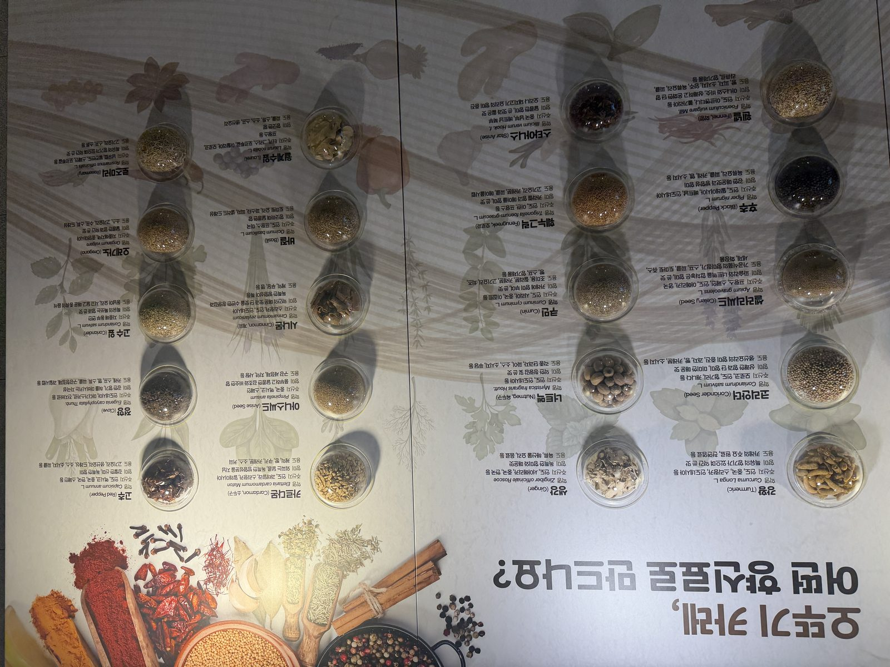
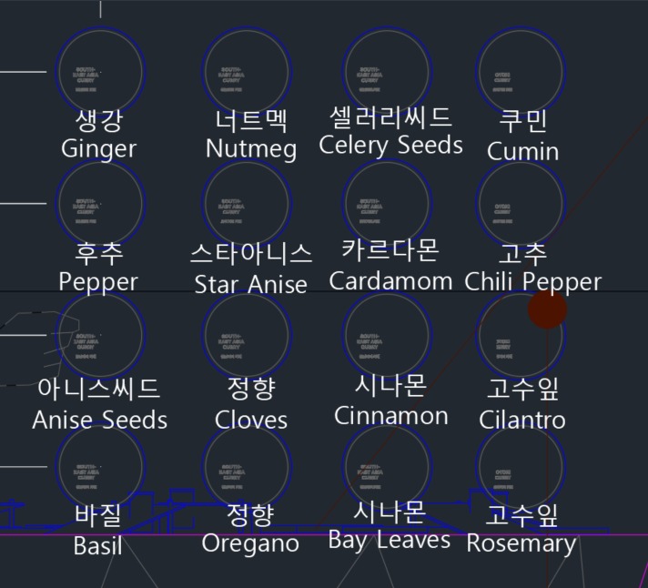

# otoki-curry-spices

전시 자료를 못 받은 상태에서, 현장 사진 한 장으로 QR 랜딩 페이지를 만들어버린 이야기

**[→ 라이브 보기](https://banhangsim.github.io/otoki-curry-spices/)**

---

## 왜 만들게 되었나

반항심은 공간디자인 스튜디오다. 전시도 한다. 이번 건은 오뚜기 전시 중 "오뚜기 카레, 어떤 향신료로 만드나요?" 섹션.

이 섹션은 **오뚜기와 별개의 외부 전시 파트너사와 공동으로 진행**되는 자리였는데, 그 공동 파트너 쪽에서 원고와 데이터 전달이 늦어졌다. 디자인 가이드도 없이, 대신 **다른 현장에서 찍은 사진 몇 장**이 "이거 참고해서 만들어 주세요"와 함께 왔다. 마감은 코앞. 거기에 "QR 찍으면 상세 설명 나오는 인터랙션도 하나 넣어주세요"가 추가됐다. (오해를 피하기 위해 적자면 — 자료 전달이 늦어진 쪽은 오뚜기가 아니라 그 공동 파트너사다.)

작은 랜딩 페이지 하나 때문에 개발업체에 외주 넘기기엔 애매하다. 견적 받고 계약하고 자료 넘기고 리뷰 돌리다 보면 마감은 지나 있다. 애초에 자료가 없는 쪽이 반항심이다.

**그래서 그냥 바이브코딩으로 만들어버렸다.** 받은 현장 사진 두 장을 클로드에 던지고, 사진에서 데이터를 뽑고, 톤앤매너를 정하고, HTML을 뽑고, 레포에 올리기까지 한 세션 안에서 끝냈다. 이 저장소는 그 과정을 그대로 둔 것이다.

---

## STEP 1 — 사진에서 데이터 꺼내기

가진 거라고는 전시 패널 사진 한 장이었다. 20종의 향신료가 유리 접시에 담겨 있고, 그 옆에 한글명·영문명·학명·주산지·향미·용도가 작은 글씨로 적혀 있다.



사진을 그대로 올리고 "엑셀로 정리해달라"고 했다. 전부 뽑히긴 했는데, 유리 반사로 학명 몇 개가 의심스러웠다. `Curcuma Longa L.` 처럼 종소명이 대문자로 찍히거나, 권위 약어(`L.`, `Maton` 같은 명명자 표기)가 빠지거나.

그래서 다음 턴에 "미세한 오타는 네가 확인하고 수정해줘. 한글 표기는 사진 기준으로 두고, 학명은 웹에서 보완해도 됨"이라고 범위를 정해줬다. 사진에서 긁은 1차본 → 웹 검증으로 권위 약어 보완 → 2차본, 이 순서로 돌렸다.

**발견한 것**: 사진을 OCR로 긁는 건 쉽지만, 신뢰할 수 있는 사실까지 올리려면 "어디서 가져온 것은 그대로 두고, 어디는 보완한다"의 경계를 매 턴마다 사람이 그어줘야 한다. AI가 스스로 긋게 두면 조용히 다 덮어쓴다.

---

## STEP 2 — 패널엔 20종, 실제론 16종

작업하는 중에 사용자(나)가 두 번째 사진을 올렸다. 실제로 전시된 향신료 캡쳐. 세어보니 16종이었다. 패널엔 20종인데 전시는 16종.



더 재밌는 건 마지막 줄의 한글-영문 불일치. 한글은 "정향·시나몬·고수잎"이 반복되는데 영문은 Oregano·Bay Leaves·Rosemary. 캡션 라벨 쪽에 뭔가 섞인 거다.

클로드가 알아서 한쪽으로 밀어버리지 않고 **"어느 쪽이 맞는지"를 물어왔다.** 영문 기준으로 가기로 했고(오레가노·월계수잎·로즈마리), 16종만 남긴 엑셀이 완성됐다.

**발견한 것**: 자료가 없다고 못 만든다는 생각부터가 틀렸다. 클라이언트가 쥐고 있는 자료보다 **현장에서 찍힌 사진이 더 정확한 1차 자료**인 경우가 많다. 패널은 "원래 하려던 것", 전시 사진은 "실제로 깔린 것". 간판은 20종이라 쓰여 있어도 손님이 보는 건 16종이다.

---

## STEP 3 — QR용 랜딩 페이지로 만들기

데이터가 정리됐으니 페이지를 짰다. 요구는 두 개:

- 1페이지 — 16개 향신료 버튼 (인덱스)
- 2페이지 — 버튼 누르면 해당 향신료 상세

디자인 톤은 "클로드 디자인 스타일(웜톤) + 오뚜기산스 폰트"로 정해줬다. 전시 바이닐과 톤이 겹치지 않으면서 종이 같은 느낌이 났으면 했고, 오뚜기산스는 어차피 전시 전체에서 쓰는 폰트라 통일성이 필요했다.

핵심 로직은 간단하다. 한 HTML 파일에 두 페이지(`#page-index`, `#page-detail`)를 넣고 자바스크립트로 보여주고 숨긴다.

```js
// 데이터는 상단 배열에 다 들어있다. 수정하려면 여기만 고치면 됨
const SPICES = [
  { ko:'생강', en:'Ginger', sci:'Zingiber officinale Roscoe',
    origin:['인도','서아메리카','중국','한국'],
    flavor:'독특한 향미와 매운맛',
    uses:['육류','해산물 요리','음료'] },
  // ... 나머지 15종
];

// 버튼 누르면 2페이지 보여주기
function showDetail(i) {
  pageIndex.hidden = true;
  pageDetail.hidden = false;
  // URL 해시도 바꿔서 QR을 특정 향신료로 바로 떨어지게도 가능
  history.replaceState({view:'detail', i}, '', `#${SPICES[i].en.toLowerCase()}`);
}
```

폰트는 `local('오뚜기산스3N Medium')` 식으로 사용자 PC에 깔린 폰트를 먼저 찾고, 없으면 Noto Sans KR로 떨어지게 했다. 전시 현장 아이패드엔 오뚜기산스가 깔려 있으니 거기선 제대로 뜨고, 관람객 핸드폰에선 Noto Sans KR로 뜬다. 둘 다 큰 어색함 없이 읽힌다.

**발견한 것**: 외주 개발업체에 넘겼으면 자료 전달 → 와이어프레임 → 디자인 시안 → 퍼블리싱 → 리뷰 몇 라운드로 최소 2주짜리 일이다. 바이브코딩으로는 **몇 번의 대화**로 끝났다. 자료 정리까지 한 세션에서. 작은 인터랙션은 외주로 넘기지 말고 그냥 만들어 쓰는 게 맞다.

---

## 완성된 것

- 단일 HTML 파일 하나. 빌드도 서버도 필요 없음 → 어떤 호스팅에 올려도 바로 QR
- 16종 향신료 인덱스 + 상세. prev/next로 순차 탐색 가능 → 관람객이 하나 보고 다음 걸로 넘어가기 쉬움
- URL 해시 라우팅 (`...#cumin`) → **품목별 QR**을 따로 만들어 해당 접시 옆에 붙이는 것도 가능
- 오뚜기 레드(#D93033) + 종이톤 배경 + 오뚜기산스 → 전시 공간과 톤이 이어짐
- 모바일 우선 레이아웃 + 스태거 애니메이션 → 핸드폰으로 QR 찍었을 때 어색하지 않음

---

## 내 것으로 바꿔 쓰기

다른 전시, 다른 품목에 그대로 쓸 수 있다. `index.html` 안의 `SPICES` 배열만 바꾸면 끝.

| 바꿀 것 | 어디 | 어떻게 |
|---|---|---|
| 품목 데이터 | `const SPICES = [...]` | 객체 하나가 한 품목. `ko/en/sci/origin/flavor/uses` 여섯 필드 |
| 품목 개수 | 같은 배열 | 몇 개를 넣든 그리드가 자동으로 재배치됨 |
| 액센트 컬러 | CSS `--accent` | 지금은 `#D93033` (오뚜기 레드) |
| 배경 톤 | CSS `--bg`, `--paper` | 종이톤 두 단계 |
| 폰트 | CSS `--font-kr` | `local()` 안 이름을 쓰려는 폰트로 바꾸면 됨 |
| 헤로 카피 | `.p1__title` 아래 | 전시 섹션 이름으로 교체 |

품목별 직접 QR이 필요하면 `https://banhangsim.github.io/otoki-curry-spices/#ginger` 같이 영문명을 소문자-대시로 바꿔 붙이면 그 품목 상세로 바로 떨어진다.

---

## 만들고 나서

전시 디자인을 하다 보면 "이 정도는 개발이 들어가야 하는데 개발까지 가긴 애매하다" 싶은 자리가 자주 생긴다. 지금까지는 그런 자리를 그냥 포기하거나, 비용과 시간이 아까워 플랜 B로 바꿔치기했다.

바이브코딩이 생기고 나서는 **"일단 만들어보고 안 되면 바꾸자"**가 가능해졌다. 자료가 없어도, 개발자가 없어도, 세션 몇 번으로 라이브 URL까지 간다. 다음 전시에서도 QR이 필요하면 또 이렇게 만들 거다.
